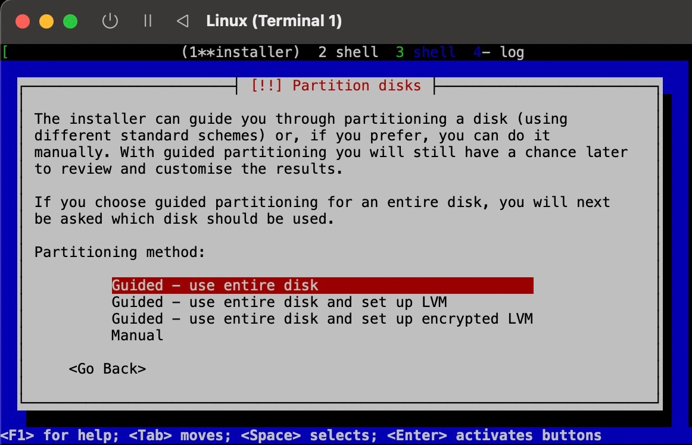
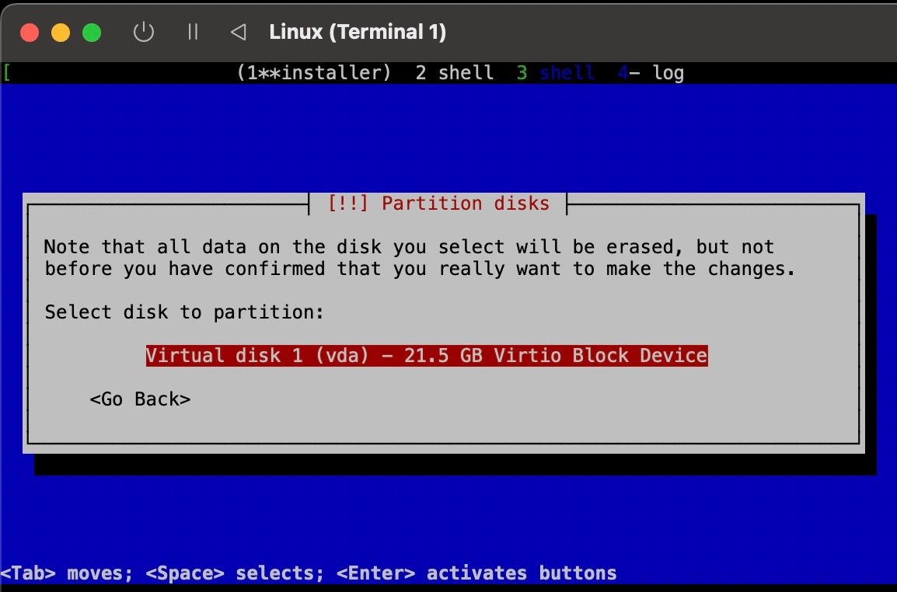
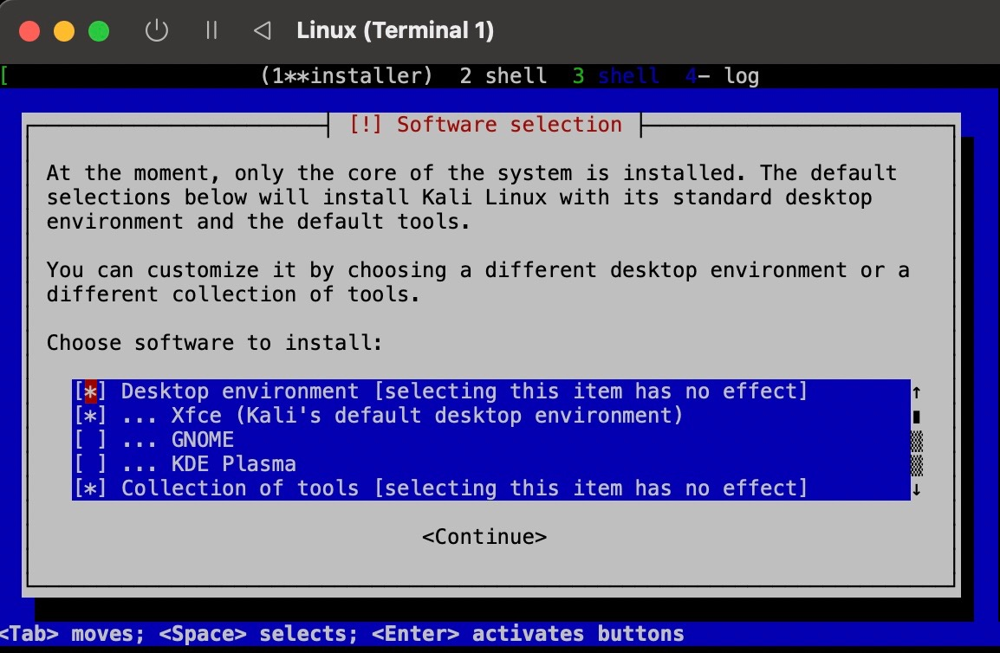
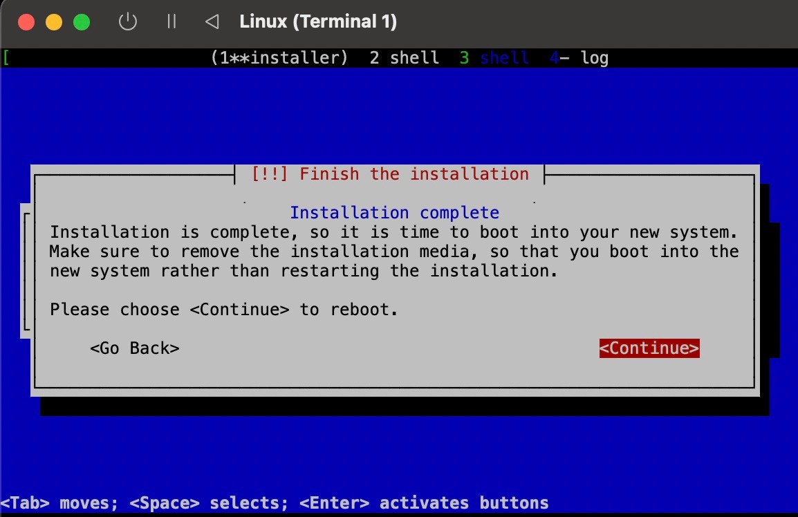
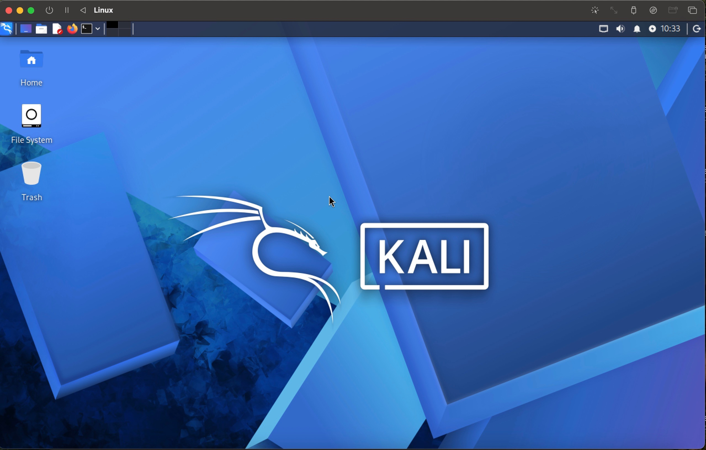

# Project 01: Kali Linux ARM64 on Apple Silicon

## Overview

This project documents the deployment of a Kali Linux ARM64 virtual machine on an Apple Silicon MacBook Pro using UTM.

The virtual machine serves as the first system in my cybersecurity homelab and establishes the environment that will be used for future Linux administration, networking, SOC analysis, detection engineering, security automation, and AI security exercises.

## Project Status

**Installation:** Completed ✅  
**Graphical Desktop:** Working ✅  
**Post-install configuration:** In progress

## Environment

| Component | Configuration |
|---|---|
| Host | Apple Silicon MacBook Pro |
| Virtualization | UTM |
| Guest OS | Kali Linux ARM64 |
| Architecture | ARM64 / aarch64 |
| Desktop | Xfce |
| Memory | 3 GB |
| Virtual Disk | 21.5 GB VirtIO |
| Networking | UTM Shared Network |
| Display | virtio-gpu-pci |
| Hostname | kali |

## Objectives

- Deploy Kali Linux as an ARM64 virtual machine
- Understand the basic UTM virtualization workflow
- Configure a functional Linux desktop environment
- Troubleshoot installation and display issues
- Establish a foundation for future cybersecurity labs
- Document the process using Git and GitHub

## Key Challenge

During installation, Kali successfully reached the boot menu, but starting the installer resulted in a blank graphical display.

The issue was resolved by configuring a Serial device in UTM and accessing the Kali installer through the Serial console.

This troubleshooting experience demonstrated that a blank virtual-machine display does not necessarily mean the guest operating system has crashed. Output may be available through another console device.

## Installation Summary

1. Created an ARM64 virtual machine in UTM
2. Attached the Kali Linux ARM64 installer
3. Booted into the Kali installer
4. Encountered the blank-screen issue
5. Added a Serial console in UTM
6. Continued installation through the Serial display
7. Configured the Kali user and system settings
8. Partitioned the 21.5 GB virtual disk
9. Installed Kali with the Xfce desktop environment
10. Removed the installer media after installation
11. Removed the temporary Serial device
12. Restored the virtio-gpu-pci graphical display
13. Successfully booted into the Kali Xfce desktop

## Documentation

Detailed documentation for this project will include:

- `installation.md` - Complete installation process
- `troubleshooting.md` - Black-screen and Serial-console troubleshooting
- `screenshots/` - Supporting screenshots from the installation

## Current Result

Kali Linux ARM64 is installed and successfully booting into the Xfce graphical desktop through UTM.

The next step is to preserve the installation documentation and screenshots before beginning post-install configuration and cybersecurity lab work.

## Visual Documentation

### Guided Partitioning

The Kali installer was configured to use the complete UTM virtual disk.

### Virtual Disk Selection

The installer detected the 21.5 GB VirtIO virtual disk provided by UTM.

### Xfce Software Selection

Xfce was retained as the desktop environment. GNOME and KDE Plasma were not selected.

### Installation Complete

Kali confirmed that installation to the virtual disk completed successfully.

### Final Result

Kali Linux ARM64 successfully booted into the Xfce graphical desktop through UTM.

## Project Documentation

- [Complete installation process](installation.md)
- [Blank-screen troubleshooting case study](troubleshooting.md)
